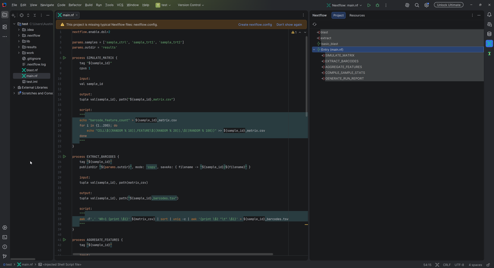
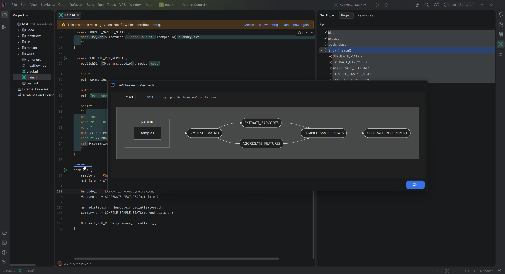
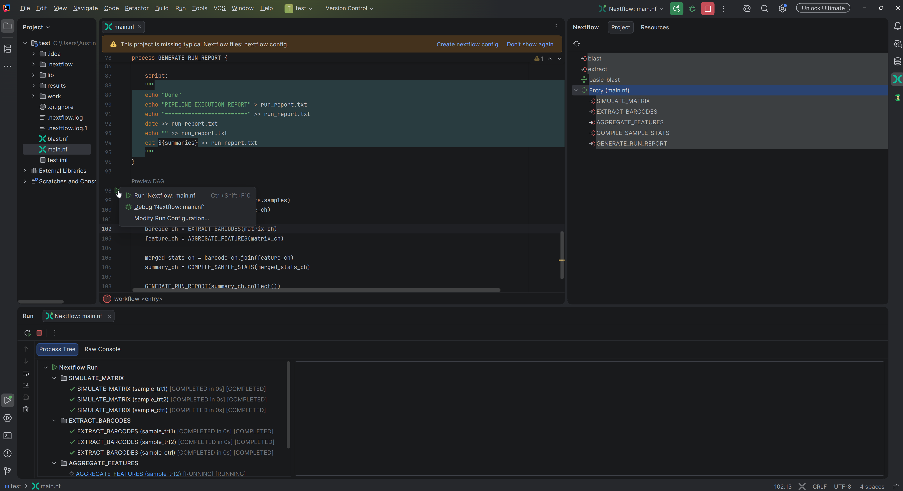
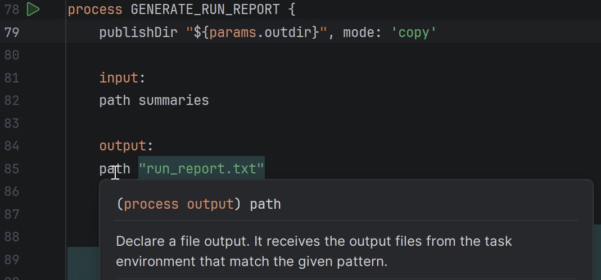
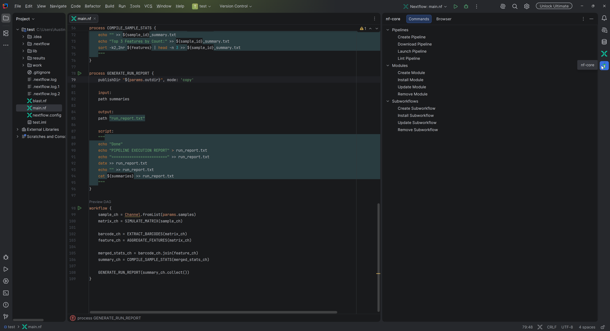
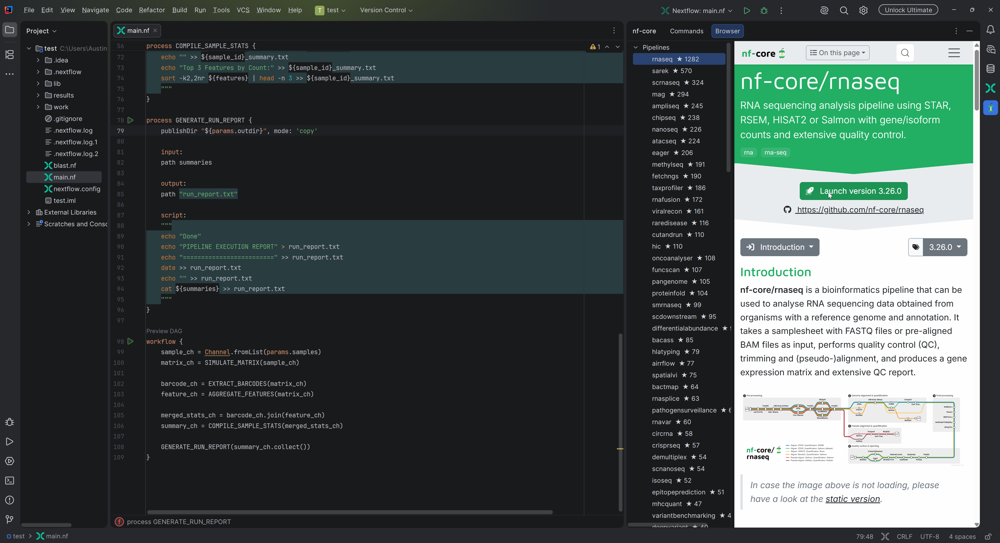
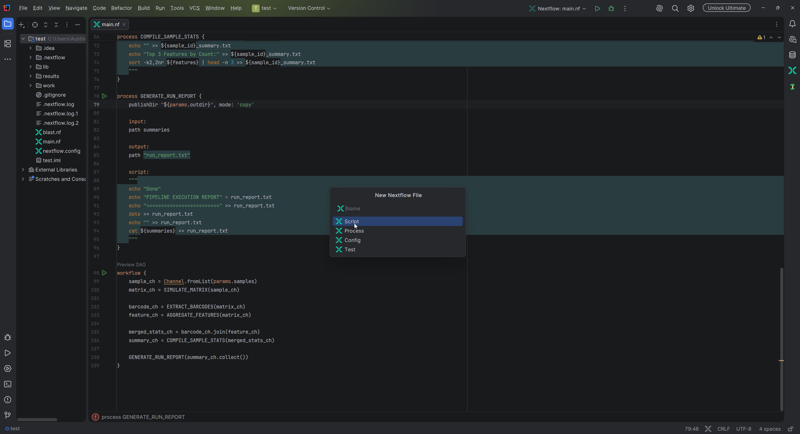
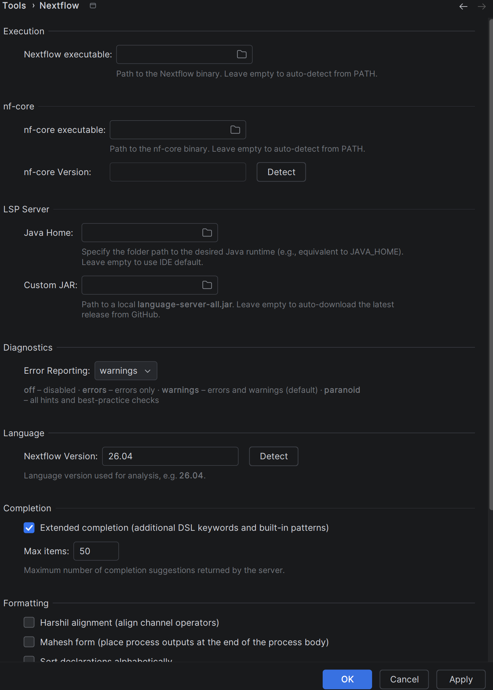

# JetBrains Nextflow Support


[](https://plugins.jetbrains.com/plugin/31666-nextflow-support)

Bring the power of Nextflow to your JetBrains IDE.

This plugin provides enhanced support for Nextflow within JetBrains environments, with a special focus on IntelliJ IDEA and PyCharm. It bridges the gap between official Nextflow tooling and native IDE capabilities.

## Features

* **Official Nextflow Language Server Support**: Real-time code completion, parameter hints, hover documentation, and error checking directly integrated via the official Nextflow Language Server Protocol (LSP).
* **Native Run & Debug Configurations**: Effortlessly create, execute, and remote-debug your Nextflow pipelines directly from the IDE. Includes full support for Windows Subsystem for Linux (WSL). Note that debugging only works on IntelliJ IDEA.
* **Official Syntax Highlighting**: Highlights Nextflow-specific syntax (like processes, workflows, channels, and operators) via official TextMate bundle integration.
* **Code Actions & Refactoring**: Use LSP-powered formatting and code actions. Static-type conversion actions appear only when the connected language server supports them; newer servers have removed these commands.
* **Process Configuration Previews**: Click **Preview config** above a process to inspect directive values, their source files, and overridden settings. Select profiles from the searchable checkbox popup to update the preview automatically; use **Refresh** after configuration changes.
* **File Templates**: Quickly bootstrap your projects with built-in templates for `.nf`, `.nf.test`, and `nextflow.config` files.
* **Interactive Nextflow Console**: Launch an interactive REPL console to test Nextflow logic directly within the IDE.
* **Dedicated Tool Windows**: Specialized project and resource panels to better manage and interact with your Nextflow environment.
* **nf-core Support**: Integrated support for managing nf-core-based pipelines, with a dedicated tool window (requires [nf-core/tools](https://github.com/nf-core/tools)).

## Screenshots









## Development

The project is built using Gradle. Here are the common commands used for development:

### Running in a Sandbox IDE
To launch a lightweight JetBrains IDE instance with the plugin installed for manual testing:
```bash
./gradlew runIde
```

Stop the sandbox IDE and rerun this command after plugin changes. Automatic plugin reloading is disabled because an unsafe reload can remove Nextflow file recognition until the IDE restarts.

### Building the Plugin
To build the complete plugin distribution (which outputs a ZIP file in `build/distributions`):
```bash
./gradlew buildPlugin
```

### Running Tests
To run the automated test suite:
```bash
./gradlew test
```

Automated tests disable embedded Chromium to keep headless runs reliable. Check graphical DAG rendering in the sandbox IDE.

## Credits / See Also

This plugin utilizes and integrates with the official Nextflow language server:
* [nextflow-io/language-server](https://github.com/nextflow-io/language-server)

Textmate bundles and feature inspiration are from the official Nextflow VSCode extension:
* [nextflow-io/vscode-language-nextflow](https://github.com/nextflow-io/vscode-language-nextflow)
